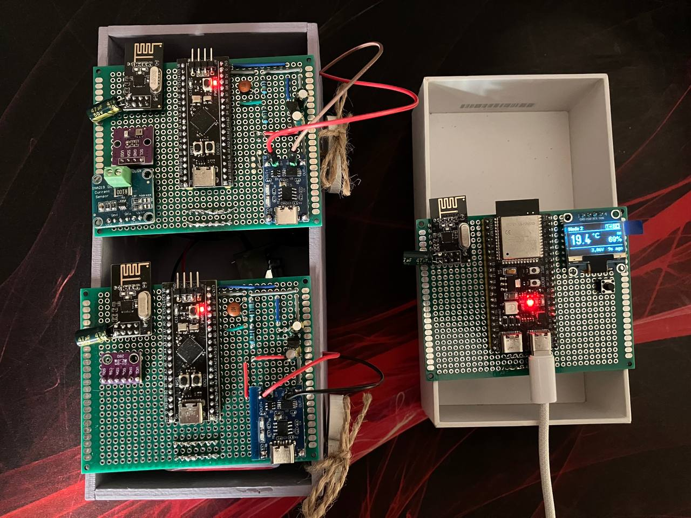
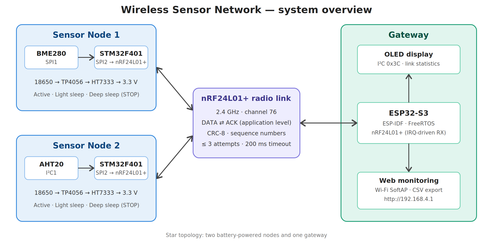
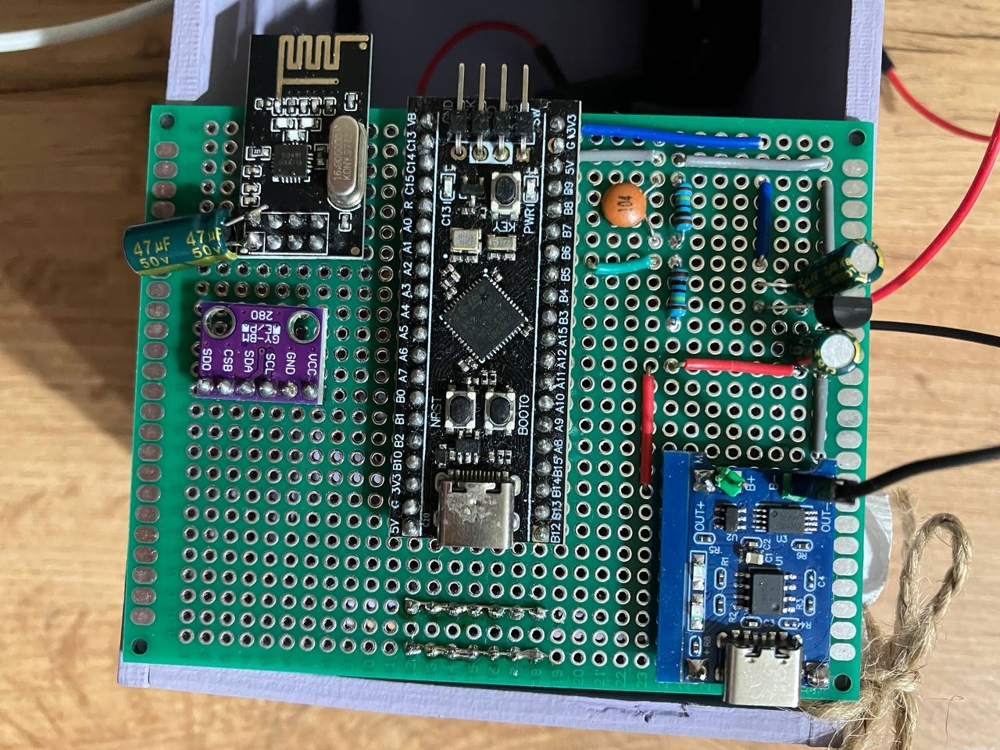
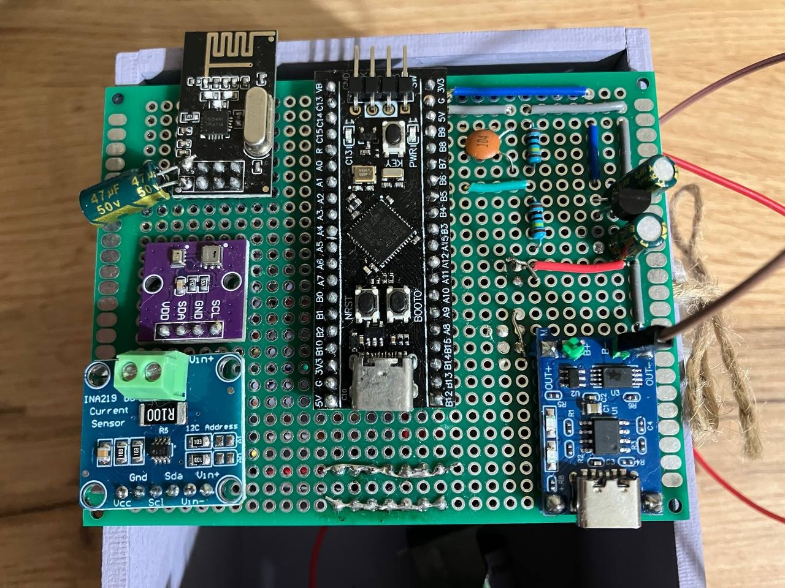
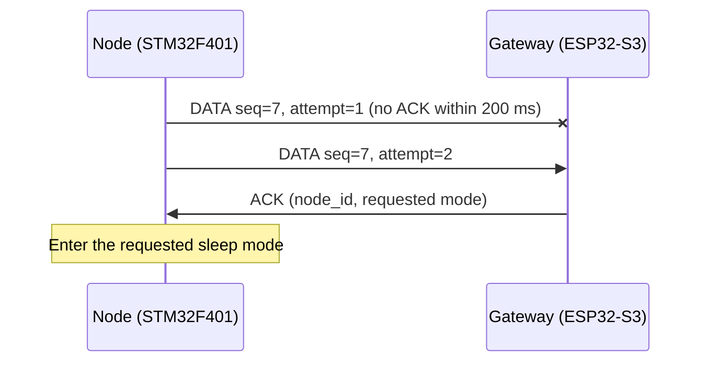
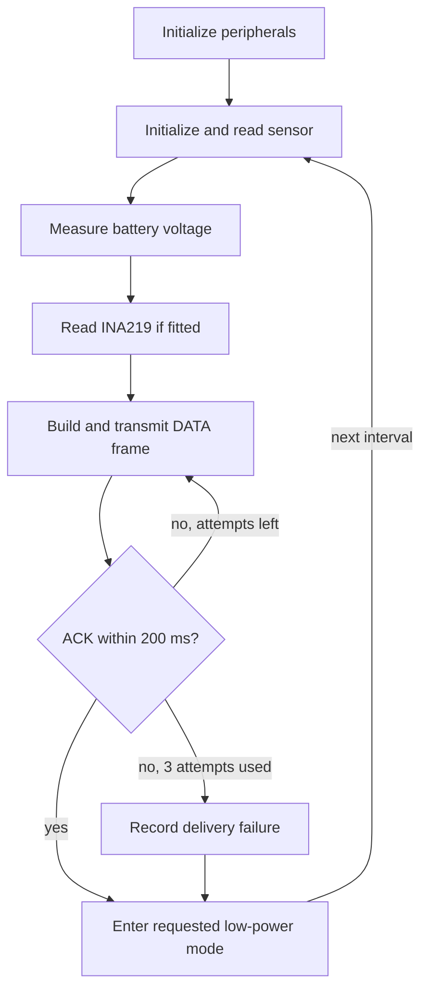
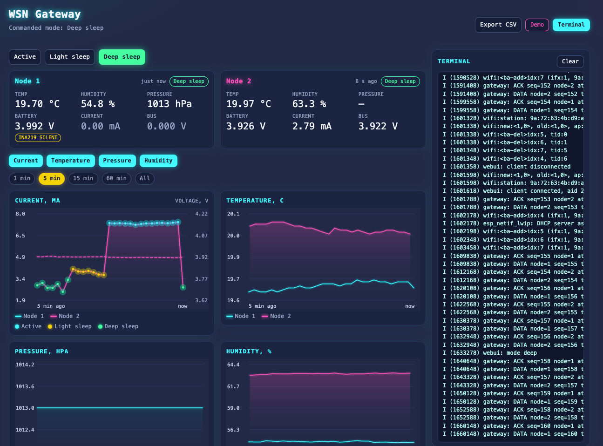
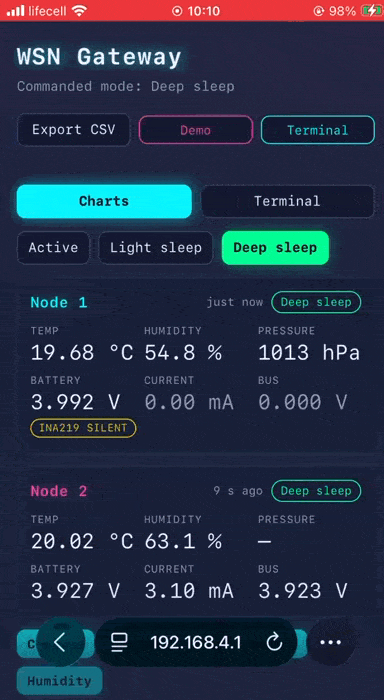

# Wireless Sensor Network


A low-power wireless sensor network built around **nRF24L01+**,
**STM32F401**, and **ESP32-S3**. Two battery-powered sensor nodes collect
environmental data and transmit it to a central gateway over a 2.4 GHz
radio link.

The project addresses practical wireless communication challenges in
embedded systems: packet loss, corrupted frames, duplicate delivery,
acknowledgement handling, and energy-efficient operation.



- **Course:** Embedded Development
- **Author:** Serhii Mazur
- **Repository:** [SerhiiMazurBeetroot/emb-wireless_sensor_network](https://github.com/SerhiiMazurBeetroot/emb-wireless_sensor_network)

## Contents

- [Wireless Sensor Network](#wireless-sensor-network)
  - [Contents](#contents)
  - [System overview](#system-overview)
  - [Features](#features)
  - [Repository structure](#repository-structure)
  - [Hardware](#hardware)
  - [Wireless protocol](#wireless-protocol)
    - [Radio link parameters](#radio-link-parameters)
    - [Frame fields](#frame-fields)
    - [Status flags](#status-flags)
    - [Delivery and duplicate handling](#delivery-and-duplicate-handling)
  - [Firmware architecture](#firmware-architecture)
    - [Gateway — ESP32-S3](#gateway--esp32-s3)
    - [Sensor nodes — STM32F401](#sensor-nodes--stm32f401)
  - [Gateway monitoring](#gateway-monitoring)
  - [Build instructions](#build-instructions)
    - [Gateway](#gateway)
    - [Sensor nodes](#sensor-nodes)
  - [Test results and limitations](#test-results-and-limitations)

## System overview



The network uses a star topology consisting of two sensor nodes and one
gateway.

| Device  | Hardware             | Sensor / peripheral            |
| ------- | -------------------- | ------------------------------ |
| Node 1  | STM32F401            | BME280 over SPI                |
| Node 2  | STM32F401            | AHT20 over I²C                 |
| Gateway | ESP32-S3 + nRF24L01+ | OLED display and web interface |

Each node periodically acquires environmental measurements, transmits a
data frame, waits for an acknowledgement, and enters a low-power state.
The gateway remains active to receive and process packets, update the
display, and provide monitoring through a local web interface.

## Features

**Radio link**

- Star topology with a central ESP32-S3 gateway.
- nRF24L01+ communication on 2.4 GHz, channel 76.
- Application-level acknowledgements with a 200 ms timeout and up to
  three transmission attempts.
- CRC-8 frame-integrity validation using polynomial `0x07`.
- Sequence-number-based duplicate detection.
- Node-status flags for startup, sensor errors, low battery, unsuccessful
  delivery, and radio errors.

**Sensor nodes**

- Two autonomous, battery-powered nodes.
- Active, Light sleep, and Deep sleep (STOP) operating modes.
- Battery-voltage monitoring through the STM32 ADC.
- INA219 current and bus-voltage monitoring where configured.

**Gateway**

- OLED status display and link statistics.
- Wi-Fi access point and browser-based monitoring.
- CSV export and presentation demo mode.

## Repository structure

```text
.
├── common/protocol/   # Frame definition shared by gateway and nodes (protocol.h)
├── gateway/           # ESP32-S3 firmware (ESP-IDF)
├── node/              # STM32F401 firmware (STM32CubeIDE)
└── docs/              # Hardware details: pins, power supply, schematics
```

## Hardware

| Component  | Function                                                           |
| ---------- | ------------------------------------------------------------------ |
| ESP32-S3   | Gateway controller, radio coordination, web interface, and display |
| STM32F401  | Low-power controller for each sensor node                          |
| nRF24L01+  | 2.4 GHz wireless communication                                     |
| BME280     | Temperature, humidity, and pressure sensing on Node 1              |
| AHT20      | Temperature and humidity sensing on Node 2                         |
| OLED       | Local gateway status and link-statistics display                   |
| INA219     | Current and bus-voltage monitoring, where fitted                   |
| 18650 cell | Sensor-node power source                                           |
| TP4056     | Battery charging; protection depends on the module variant         |
| HT7333     | 3.3 V regulation for the sensor node                               |

Each sensor node is powered by a single 18650 cell:
`18650 → TP4056 → HT7333 → 3.3 V rail`.

> [!WARNING]
> The nRF24L01+ modules must be powered from **3.3 V**. Do not connect the
> nRF24L01+ VCC pin to 5 V.

Pin assignments, power-supply details, battery and current measurement are
described in **[docs/hardware.md](docs/hardware.md)**.

| Node 1 (BME280, SPI)             | Node 2 (AHT20, I²C)              |
| -------------------------------- | -------------------------------- |
|  |  |

## Wireless protocol

The gateway and node firmware share a common protocol definition:

[`common/protocol/include/protocol.h`](common/protocol/include/protocol.h)

### Radio link parameters

| Parameter        | Value                                                                         |
| ---------------- | ----------------------------------------------------------------------------- |
| Frequency        | 2.4 GHz, channel 76 (2476 MHz)                                                |
| Acknowledgements | Application level; hardware Auto-ACK disabled (`EN_AA = 0`, `SETUP_RETR = 0`) |
| ACK timeout      | 200 ms                                                                        |
| Maximum attempts | 3                                                                             |
| Frame integrity  | CRC-8, polynomial `0x07`                                                      |
| Radio supply     | 3.3 V                                                                         |

Channel 76 lies above the upper edge of Wi-Fi channels 1–11 (2473 MHz), which
limits interference with the gateway SoftAP when it is configured on one of
those channels.

### Frame fields

| Field           | Purpose                                                             |
| --------------- | ------------------------------------------------------------------- |
| `type`          | Frame type                                                          |
| `node_id`       | Source node identifier                                              |
| `seq`           | Sequence number used for duplicate detection                        |
| `flags`         | Node status and error flags                                         |
| `attempt`       | Transmission attempt number                                         |
| Sensor values   | Temperature, humidity, and pressure                                 |
| Battery voltage | Node battery measurement                                            |
| `mode`          | Sleep mode used during the preceding interval                       |
| INA219 values   | Current (`current_ua`) and bus voltage (`vbus_mv`), where available |
| CRC-8           | Frame-integrity check using polynomial `0x07`                       |

`node_id` identifies the source node. Since the current network has a
single gateway, DATA frames do not include a separate destination field.
The gateway's ACK identifies the node and communicates the operating mode
requested for its next cycle.

### Status flags

| Flag         | Description                                                                                                                             |
| ------------ | --------------------------------------------------------------------------------------------------------------------------------------- |
| `BOOT`       | The node has restarted and its sequence counter has reset. The gateway resynchronizes instead of interpreting the reset as packet loss. |
| `SENSOR_ERR` | The sensor did not respond. Measurement fields are set to zero, but the node continues transmitting status frames.                      |
| `LOW_BAT`    | Battery voltage is below 3.4 V.                                                                                                         |
| `PREV_LOST`  | The previous frame did not receive an ACK after three attempts.                                                                         |
| `RADIO_ERR`  | The node radio failed to transmit the frame.                                                                                            |

`PREV_LOST` and `RADIO_ERR` remain set until a frame carrying the relevant
status is acknowledged. This allows the node to report a communication
failure again if the initial status frame is lost.

### Delivery and duplicate handling

Hardware Auto-ACK is disabled. Acknowledgement and retry behaviour are
implemented in firmware.

1. A node transmits a DATA frame and waits up to 200 ms for an ACK.
2. If no ACK arrives, the node retransmits the same frame. A maximum of
   three attempts is allowed.
3. The gateway validates the CRC before accepting a frame as a measurement.
4. The gateway uses `node_id` and `seq` to identify frames that have
   already been processed.
5. A valid duplicate is acknowledged again, but it does not trigger another
   measurement update.
6. If all attempts fail, the node records the delivery failure and returns
   to its sleep cycle.

The example below corresponds to the retransmission observed in the bench
test (sequence number 7).



The `attempt` field allows the gateway to count transmission attempts,
including attempts for which no frame was received.

The protocol mechanisms have distinct responsibilities:

- **CRC-8** detects accidental frame corruption.
- **Sequence numbers** distinguish new frames from retransmissions.
- **ACKs** confirm successful delivery to the gateway.
- **Status flags** communicate the node's operating and error state.

CRC detects errors; it does not correct corrupted data or guarantee
detection of every possible error pattern.

## Firmware architecture

### Gateway — ESP32-S3

The gateway is developed with ESP-IDF and uses FreeRTOS. Radio reception is
separated from application-level packet processing:

- The nRF24L01+ IRQ line is connected to GPIO7.
- The interrupt signals the `nrf24_rx` task; the interrupt handler does not
  read the radio FIFO.
- The receive task reads incoming frames and places them in an eight-entry
  FreeRTOS queue.
- `app_main` waits for queued frames, validates them, handles ACKs, updates
  statistics, and refreshes the display.
- Access to the radio over SPI is protected by a mutex because reception
  and ACK transmission share the peripheral.

The receive task also checks the radio FIFO every 100 ms as a fallback in
case an IRQ edge is missed.

The initial implementation continuously polled the radio FIFO from
`app_main`. This kept the CPU busy and triggered the task watchdog. After
reception was moved to an IRQ-driven task and queue, the watchdog did not
trigger during the recorded test run.

Before transmitting an ACK, the gateway waits 1.5 ms. This delay was
selected during bench testing to allow the node to switch back to receive
mode. It is an implementation timing value, not an oscilloscope-verified
measurement.

### Sensor nodes — STM32F401

Each node runs a sequential state machine. The nodes do not use a queue:
sensor acquisition, radio communication, ACK handling, and sleep are
performed one after another.



The nRF24L01+ IRQ pin is not connected on the sensor nodes; ACK waiting
currently uses 1 ms polling.

The gateway communicates the requested operating mode in its ACK:

| Mode        | Node behaviour                          |
| ----------- | --------------------------------------- |
| Active      | Remains active between reporting cycles |
| Light sleep | Uses WFI while retaining SYSCLK         |
| Deep sleep  | Enters STM32 STOP mode                  |

The current demonstration interval is 10 seconds. The intended operating
interval is 60 seconds; the shorter interval is used to make live
demonstrations easier.

## Gateway monitoring

The gateway starts a Wi-Fi SoftAP:

| Setting       | Value                |
| ------------- | -------------------- |
| SSID          | `WSN-Gateway`        |
| Password      | `wsn-gateway`        |
| Web interface | <http://192.168.4.1> |

> [!NOTE]
> These are demonstration credentials, and the web interface is served over
> plain HTTP without authentication. Change the password before using the
> gateway outside a lab setting.

The web interface provides:

- operating-mode selection (Active, Light sleep, Deep sleep);
- current and bus-voltage charts from INA219;
- temperature, humidity, and pressure charts;
- CSV export;
- a log terminal;
- a demo mode for presentations without connected sensor nodes.

| Png                                     | Gif                                     |
| --------------------------------------- | --------------------------------------- |
|  |  |

The OLED displays one node at a time, including its measurements, battery
voltage, and time since its last received frame. The display rotates
between nodes every five seconds. A newly received frame immediately
selects the corresponding node.

A node is marked **OFFLINE** after approximately 32 seconds without a
received frame. Sensor errors are shown explicitly instead of leaving stale
measurements on screen. Low battery is indicated using inverted display
colours.

A button switches the OLED to a link-statistics view showing received
frames, lost frames, retransmissions, duplicates, and restarts.

The display is implemented using the
[u8g2 graphics library](https://github.com/olikraus/u8g2).

## Build instructions

### Gateway

**Requirements:** ESP-IDF 5.5.

From the `gateway` directory:

```bash
idf.py build flash monitor
```

### Sensor nodes

Open the `node` project in STM32CubeIDE. Build the firmware with the
appropriate configuration:

| Node   | `PKT_NODE_ID` | `NODE_USE_AHT20` | Sensor interface |
| ------ | ------------- | ---------------- | ---------------- |
| Node 1 | `0x01`        | `0`              | BME280 over SPI1 |
| Node 2 | `0x02`        | `1`              | AHT20 over I²C1  |

Node debug output is available through USART1 at 115200 baud, using 3.3 V
logic levels. For wiring, see [docs/hardware.md](docs/hardware.md#pin-assignments).

## Test results and limitations

The following results were observed during an indoor bench test using
nRF24L01+ modules without PA/LNA amplifiers, channel 76, and a 3.3 V radio
supply.

| Test                          | Observed result                                                                                                          |
| ----------------------------- | ------------------------------------------------------------------------------------------------------------------------ |
| Communication from both nodes | Both nodes delivered sensor data to the gateway.                                                                         |
| Node 1 measurement snapshot   | 23.23 °C, 64.68 % humidity, 1010 hPa                                                                                     |
| Node 2 measurement snapshot   | 23.79 °C, 74.49 % humidity; the AHT20 does not measure pressure.                                                         |
| Retransmission                | For sequence number 7, the first attempt did not receive an ACK within 200 ms; the ACK arrived after the second attempt. |
| Gateway watchdog              | The task watchdog did not trigger during the recorded test run.                                                          |
| Battery measurement           | A divider midpoint of 1.860 V corresponded to an estimated battery voltage of approximately 3.72 V.                      |

These values represent a single bench-test snapshot, not long-term
statistical results.
